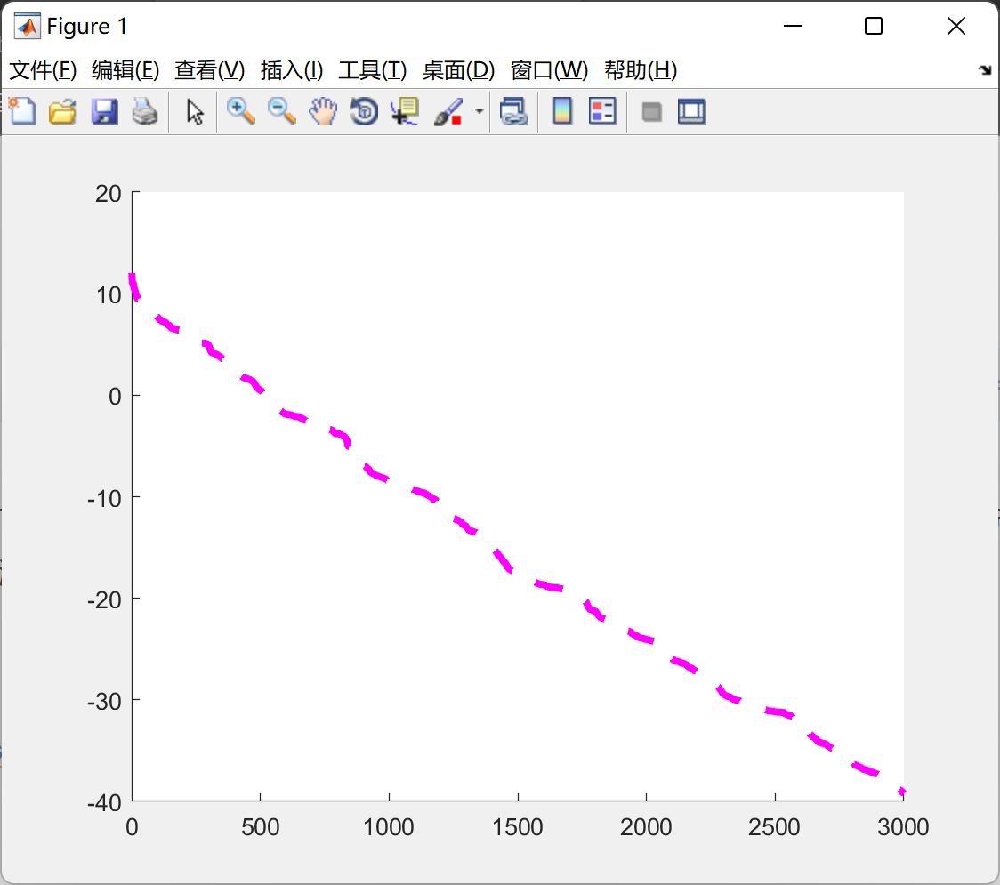

# Turbulence Flow Optimization Algorithm (TFWO) (Matlab Code Implementation)

Turbulence-based optimization (TFWO) is a new effective grouping optimization algorithm inspired by the natural search phenomenon, which is the vortex generated in turbulence. In this algorithm, the issue of selecting control parameters is eliminated, and the convergence power is improved. The algorithm has a fixed
Structure.
Reference paper: https://doi.org/10.1016/j.engappai.2020.103666
\n        \n      \n        \n  

## Images

<!-- PAYMENT_BLOCK -->

## Get this dataset

- Payment link (Stripe): [Buy now](https://buy.stripe.com/3cs8yP7sY87d0vu9AB)
- Payment QR code: 

<!-- /PAYMENT_BLOCK -->
